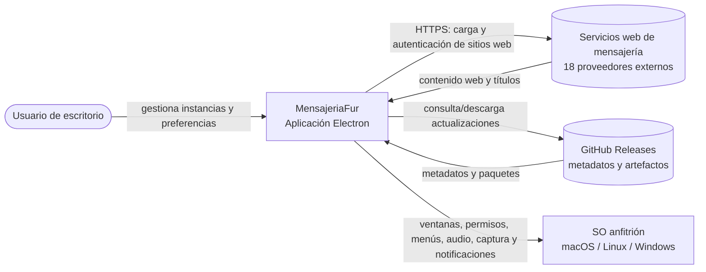

# 2. Contexto C4 (C1)

## Actores y sistemas externos

| Elemento | Relación | Evidencia |
|---|---|---|
| Usuario | Crea, ordena, activa y elimina instancias; configura preferencias y controla la descarga de updates. | `src/renderer.js:95-165,258-274`; `src/preload.js:4-43` |
| Servicios web | Sitios de terceros cargados dentro de `WebContentsView`; la autenticación y la lógica de producto pertenecen al proveedor. | `src/main.js:65-94,766-842,1022-1024`; `specs/servicios.md:5-24` |
| GitHub Releases | Proveedor configurado para publicación y origen usado por `electron-updater`. | `package.json:132-138`; `.github/workflows/release.yml:58-68,109-118,150-158` |
| Sistema operativo | Proporciona ventanas, menús, permisos multimedia, captura de pantalla, notificaciones y mecanismos de empaquetado. | `src/main.js:1,520-536,773-825,1590-1652`; `package.json:28-139` |

El flujo de mensajes, credenciales de cuenta y disponibilidad de los sitios es propiedad de cada servicio externo; este proyecto ofrece el shell y el almacenamiento local del perfil web.
