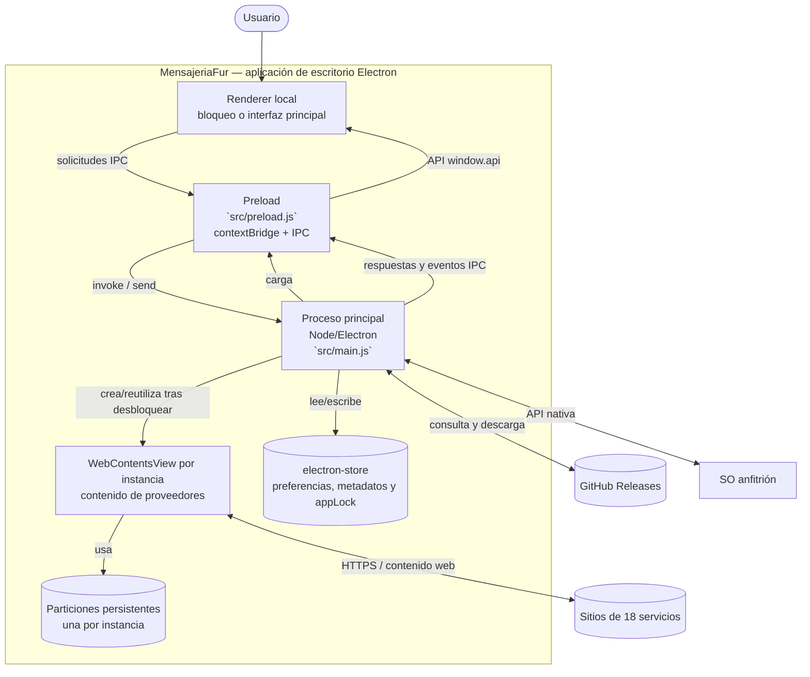

# 3. Contenedores C4 (C2)

## Responsabilidades y límites

### Proceso principal

`src/main.js` crea la ventana, carga datos de `electron-store`, registra handlers IPC, mantiene el catálogo de servicios, gestiona vistas/sesiones/permisos, integra el updater y aplica adaptaciones del SO. Es el único punto del producto que usa APIs privilegiadas de Electron.

También controla el estado de bloqueo y consulta/solicita Touch ID en macOS. Delega derivación y comparación de contraseñas al módulo Node local `src/app-lock.js` (`src/main.js:117-205`; `src/app-lock.js:1-25`). No se añadió un backend de autenticación.

### Renderer local y preload

`src/index.html`, `src/renderer.js` y `src/styles.css` presentan la UI principal; `src/lock.html` y `src/lock.js` forman la pantalla alternativa previa al acceso. Comparten preload, pero el proceso principal rechaza las operaciones de producto mientras permanece bloqueado. El preload traduce métodos predefinidos a `ipcRenderer.invoke/send` y eventos; no expone el objeto `ipcRenderer` completo (`src/preload.js:1-47`; `src/main.js:1398-1414`).

### Vistas de proveedores y almacenamiento

Cada instancia habilitada puede tener un `WebContentsView` propio tras desbloquear. `session.fromPartition('persist:<id>')` conserva cookies y almacenamiento del proveedor; `electron-store` conserva estado/configuración de la aplicación y el registro opcional de protección, no las credenciales de los proveedores (`src/main.js:575-598,864`; `src/app-lock.js:10-22`).

No se detectó base de datos remota ni servicio backend propio en el alcance revisado. Las comunicaciones de negocio se realizan entre vistas de proveedor y los endpoints web definidos por esos proveedores.
