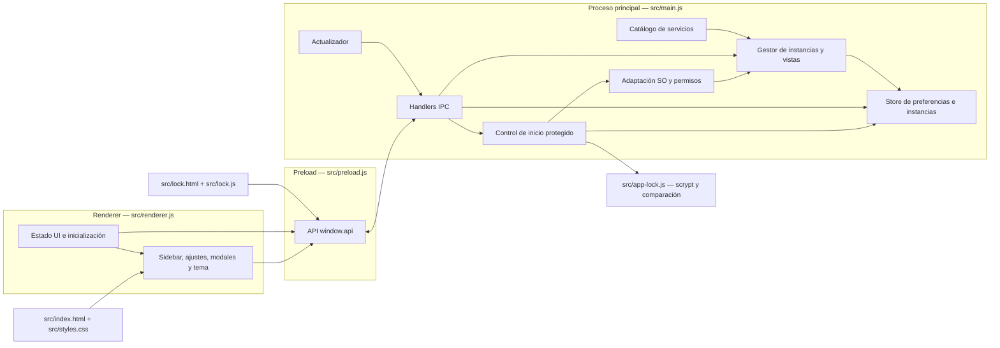

# 4. Componentes C4 (C3)

## Responsabilidades observadas

| Componente | Responsabilidad | Evidencia |
|---|---|---|
| Catálogo de servicios | URL base, nombre, color y user-agent opcional para 18 integraciones. | `src/main.js:67` |
| Gestor de instancias/vistas | Crea sesiones persistentes y vistas; impide creación/activación mientras está bloqueado. | `src/main.js:864,1084,1154,1260` |
| Persistencia | Carga preferencias, instancias y órdenes; determina el bloqueo desde el registro opcional `appLock`. | `src/main.js:575-598` |
| Inicio protegido | Valida emisor, serializa autenticaciones, solicita Touch ID o verifica contraseña, activa/desactiva y desbloquea. | `src/main.js:117-205` |
| Contraseña local | Deriva hash scrypt con salt aleatorio y compara en tiempo constante. | `src/app-lock.js:6-22` |
| Handlers IPC | Exige ventana/frame principal de origen local y aplicación desbloqueada para las operaciones de producto. | `src/main.js:1398-1414` |
| API preload | Añade estado público y acciones de protección sin exponer hash/salt. | `src/preload.js:4-5` |
| Estado/UI principal | Inicializa estado, incluye Seguridad en ajustes y procesa eventos. | `src/renderer.js:97,400,577` |
| Pantalla de bloqueo | Solicita Touch ID automáticamente o contraseña; muestra errores y permite reintentar. | `src/lock.html:1`; `src/lock.js:7-43` |
| Presentación | HTML principal y tokens CSS compartidos; componentes de autenticación. | `src/index.html:1`; `src/styles.css:1-66` |
| Actualizador | Comprueba metadatos, permite descarga manual y comunica progreso/resultado. | `src/main.js:1545,1661` |

## Reglas de dependencia observadas

1. La UI local usa solo `window.api`; la creación de APIs nativas requiere una entrada explícita en preload y un handler asociado en el proceso principal.
2. El proceso principal es dueño del estado durable y de las sesiones; el renderer presenta/copleta operaciones y no accede directamente a `electron-store`.
3. Las vistas externas no forman parte del renderer local. La visibilidad de `WebContentsView` se controla desde el proceso principal a través de un mensaje IPC.
4. Las definiciones de servicios son consumidas por el gestor de instancias; no existe una carpeta/adaptador individual por proveedor en la estructura actual.
5. La pantalla de bloqueo no inicia el renderer principal: el proceso principal solo carga `index.html` tras autenticar. La protección no se delega a ocultar elementos DOM.
