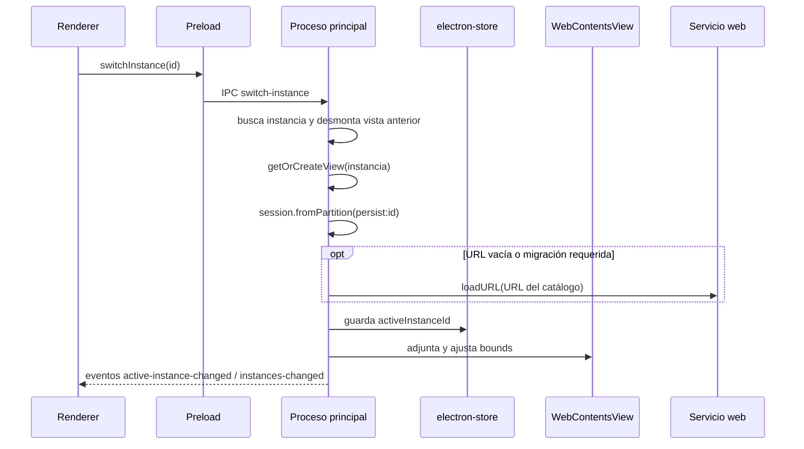
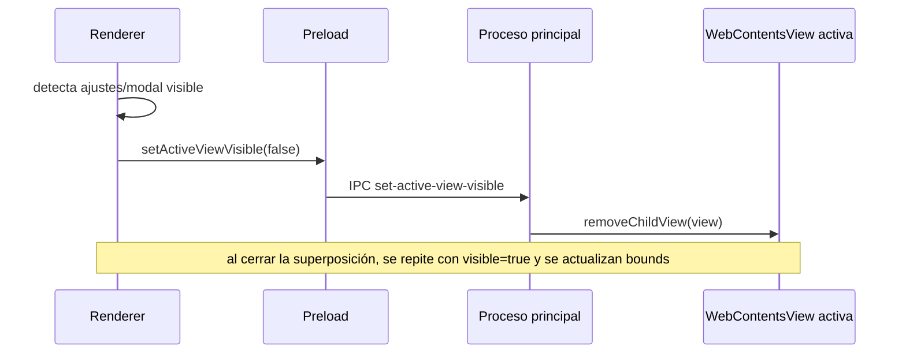

# 5. Flujos de ejecución

## Arranque de la aplicación

```mermaid
sequenceDiagram
  participant OS as Electron / SO
  participant Main as src/main.js
  participant Store as electron-store
  participant Window as BrowserWindow
  participant Preload as src/preload.js
  participant UI as Renderer local

  OS->>Main: app.whenReady()
  Main->>Store: initStore() / carga defaults y estado
  Main->>Main: setupIpcHandlers() + setupLockIpc()
  Main->>Window: createWindow()
  Main->>Main: setupAutoUpdater() / programa consulta automática
  Window->>Preload: carga preload con contextIsolation
  alt existe appLock
    Window->>UI: loadFile(src/lock.html)
    UI->>Main: app-lock-action(unlock)
    Main->>Main: Touch ID o verificación scrypt
    alt autenticación correcta
      Main->>Main: appLocked=false / reconstruye menú
      Main->>Window: loadFile(src/index.html)
    else error o cancelación
      Main-->>UI: error; sigue bloqueado
    end
  else protección desactivada
    Window->>UI: loadFile(src/index.html)
  end
  Note over UI,Main: Solo index.html inicializa los servicios; lock.html no solicita datos de instancias
  opt se ha accedido a index.html
    UI->>Preload: obtiene estado inicial
    Preload->>Main: ipcRenderer.invoke(...)
    Main-->>Preload: datos iniciales
    Preload-->>UI: resuelve API
    UI->>UI: renderiza sidebar, bienvenida y preferencias
  end
```

Orden verificado en `src/main.js:164-205,575-598,612-692,1717`; `src/renderer.js:97`; `src/lock.js:7-43`. `did-finish-load` no activa servicios mientras `appLocked` sea verdadero. La configuración del updater y su consulta automática siguen ocurriendo al arrancar; no dependen del desbloqueo.

## Activación, desactivación y reintentos del bloqueo

- En Ajustes → Seguridad, `enable` solicita Touch ID si `canPromptTouchID()` es verdadero en macOS; en otro caso exige crear y confirmar contraseña. Solo se guarda `appLock` tras completar la operación.
- `disable` solo se admite desbloqueado y vuelve a autenticar antes de eliminar el registro.
- Los errores y cancelaciones conservan el estado de protección. Cinco contraseñas incorrectas activan una espera de 30 segundos; los contadores son locales al proceso y `authBusy` rechaza peticiones simultáneas.
- Si el Touch ID ya configurado deja de estar disponible no hay fallback automático a contraseña. No hay recuperación de contraseña ni bloqueo por inactividad. En macOS, reabrir una ventana sin terminar el proceso no equivale a reiniciar la app.

Fuentes: `src/main.js:124-205`; `src/app-lock.js:6-22`; `specs/funcionalidades.md`.

## Activación de una instancia



Fuentes: `src/preload.js:13`; `src/main.js:1084,1154` (rechazan la operación mientras está bloqueado).

## Modal o panel superpuesto



Fuentes: `src/renderer.js`, función `syncNativeViewVisibility`; `src/main.js:1154,1503`.

## Actualización

El proceso principal configura `electron-updater`, comprueba automáticamente poco después del arranque y entrega estados al renderer. La descarga se ejecuta bajo demanda de la UI (`src/main.js:1545,1661,1744`; `src/preload.js:41-46`).
