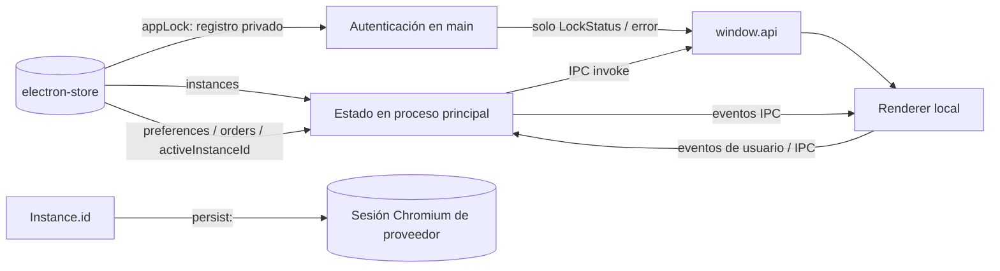

# 3. Mapeo entre almacenamiento e interfaz

## Persistencia local de la aplicación

| Clave | Forma | Consumidor | Escritura / ciclo de vida |
|---|---|---|---|
| `instances` | `Instance[]` | Sidebar, panel de ajustes, proceso principal | Alta, edición, habilitar/deshabilitar y baja (`src/main.js:1260,1285,1339`). |
| `sidebarOrder` | `string[]` | Sidebar y menú nativo | Inicializa con alta y guarda reordenamiento por separado (`src/main.js:1260,1387`). |
| `settingsOrder` | `string[]` | Lista de ajustes | Inicializa con alta y guarda orden independiente (`src/main.js:1260,1393`). |
| `activeInstanceId` | UUID o `null` | Inicio/restauración y selección | Se persiste al cambiar instancia y se limpia si deja de existir/estar habilitada (`src/main.js:575,1084`). |
| `preferences` | `Preferences` + extensiones actuales | Ajustes, tema, audio, notificaciones, idioma y arranque | Normalizada al leer y actualizada por IPC (`src/main.js:566,575`). |
| `appLock` | `AppLockRecord` opcional | Proceso principal; la UI recibe solo `LockStatus` | Creado tras activar correctamente, usado en arranque/verificación y eliminado tras desactivar con autenticación (`src/main.js:132-205,591`). |

El renderer principal obtiene colecciones por IPC al iniciar (`src/renderer.js:97`) y usa eventos IPC para reflejar cambios posteriores. Si hay protección, primero se carga `lock.html`: consulta `LockStatus` y envía la contraseña o solicita Touch ID; no obtiene instancias. Tras autenticar se carga `index.html` y se inicia la UI habitual (`src/main.js:174-178,633,672-687`; `src/lock.js:7-43`).

`preferences` no permite activar/desactivar el bloqueo: el registro se gestiona con `appLockAction`, no con `updatePreferences`. Desactivar el bloqueo no borra las sesiones ni cambia las preferencias.

## Sesiones de proveedor

`Instance.id` sirve como identificador de `session.fromPartition('persist:<id>')`. Esa partición mantiene cookies y almacenamiento web de la cuenta. Al deshabilitar se destruye la vista, no la partición; al eliminar se limpia la partición y se quitan IDs de las listas de orden (`src/main.js:864,1285,1339`).

## Mapeo de catálogo

El proceso principal mantiene `SERVICE_TYPES` con metadatos de presentación/origen. `get-service-types` expone solo `id`, `name` y `color` a la UI, no el URL ni user-agent (`src/main.js:67,1421`). La instancia conserva `serviceType`, no una copia del catálogo completo.
